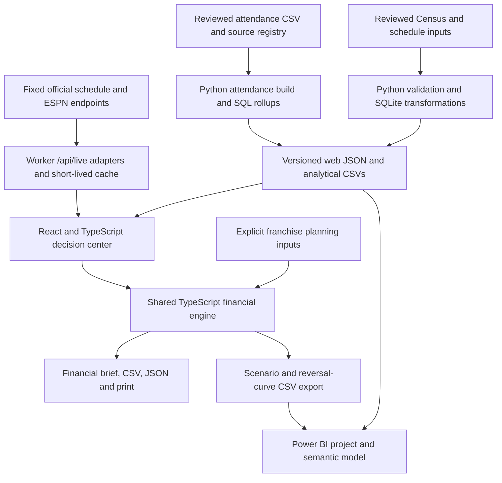

# NOLA PULSE

**Commercial decision intelligence for the New Orleans Saints and Pelicans.**

NOLA PULSE turns a campaign planning question into a reviewable financial case: what to spend, what incremental ticket revenue would follow under the stated inputs, and what would make the decision stop working. A franchise-specific decision brief connects an editable economic model to historical attendance evidence and regional research.

This is an independent portfolio implementation. The financial cases are authored planning examples, not measured or estimated franchise financial results. The historical attendance records are public observations. There is no trained ML model or validated demand forecast in this release.

[System design](docs/ARCHITECTURE.md) · [Financial model](docs/FINANCIAL-MODEL.md) · [Attendance evidence](docs/ATTENDANCE.md) · [Three-minute walkthrough](docs/WALKTHROUGH.md) · [Power BI handoff](powerbi/README.md)

## The decision workflow

1. **Review the economics.** The opening brief shows media spend, incremental ticket revenue, net incremental contribution, and contribution ROI. One revenue-to-contribution chart reconciles the costs.
2. **Challenge the recommendation.** A calculated reversal threshold identifies the incremental share of attributed orders required to break even. A 40% incrementality stress case makes the downside visible.
3. **Change the inputs.** Each franchise has a separate planning case, editable inputs, and pinned simulator comparison. Switching teams changes the franchise identity and its case, without overwriting the other team's work.
4. **Inspect the evidence.** Attendance has its own historical analysis. Markets provides a county map and demographic context. The metric library and evidence view expose definitions, source references, and unavailable connections.
5. **Export the case.** Financial JSON/CSV exports retain the inputs and calculated outputs; printable briefs include a provenance appendix. Attendance and market views export their own research context.

The product separates the commercial decision from supporting research. Census population is not treated as a count of fans; attendance is not treated as realized ticket revenue.

## Current financial cases

Both cases use a $25,000 media budget for a comparable spend basis. Their acquisition costs, incrementality, order sizes, ticket yields, and other costs differ explicitly in [campaign-plans.json](web/data/campaign-plans.json). No franchise-name multiplier changes the results.

| Calculated outcome | Pelicans group-ticket pilot | Saints regional ticket pilot |
| --- | ---: | ---: |
| Incremental ticket revenue | $41,250 | $50,000 |
| Variable ticket costs | $7,500 | $10,000 |
| Media and other campaign costs | $26,200 | $27,500 |
| Net incremental contribution | $7,550 | $12,500 |
| Contribution ROI | 28.8% | 45.5% |
| Break-even incremental share | 46.58% | 34.38% |
| Net contribution at 40% incrementality | −$3,700 | $4,500 |

These are reproducible scenario calculations, not forecasts of campaign lift. Contribution ROI divides net contribution by media plus other campaign costs. Variable ticket costs are already deducted from net contribution. Net contribution is not a measure of total franchise profit.

For media budget `B`, cost per attributed order `C`, incremental share `i`, tickets per order `T`, ticket yield `P`, variable cost per ticket `V`, and other campaign costs `F`:

```text
Attributed orders          Q = B / C
Incremental ticket revenue R = Q × i × T × P
Net contribution           N = Q × i × T × (P − V) − B − F
Break-even incremental share = (B + F) / (Q × T × (P − V))
Contribution ROI             = N / (B + F)
```

The threshold holds other inputs fixed. Values above 100% remain visible as infeasible; an undefined threshold stays unavailable. Calculations retain full precision and round only for display. See [Financial model](docs/FINANCIAL-MODEL.md) for inputs, edge cases, and the measurement requirements for a real campaign.

## Evidence coverage

| Dataset | Current scope | Treatment |
| --- | --- | --- |
| Historical attendance | 109 completed New Orleans home games; three seasons per franchise, reviewed November 10, 2026 | Versioned CSV, source URLs, retrieval metadata, payload hashes, explicit correction/exclusion rules |
| Regional context | Six parish/county records reviewed from Census QuickFacts | Population and income vintages remain attached; descriptive comparisons only |
| Home schedules | Official Saints and Pelicans websites | Live adapters with dated fallback context and explicit freshness states |
| Current game context | ESPN public NBA/NFL scoreboard feeds | Attributed third-party coverage, separate from historical evidence |
| Campaign economics | Two authored franchise planning cases | Editable assumptions; never calibrated from population or attendance |
| Primary sales, inventory, CRM, campaign results | Not connected | No fabricated observations or implied private access |

Attendance comparisons match the same number of home dates in consecutive seasons. They do not compare a partial-season total with a full-season total. The historical series excludes the Saints' Paris home designation and a postponed Pelicans placeholder. One zero attendance field is corrected using an independently identified official NBA observation. [Attendance evidence](docs/ATTENDANCE.md) records the exact rules and sources.

## System design



The serving application uses React 19 and TypeScript with Vinext/Vite, deployed as a Cloudflare Worker. Python's standard library and SQLite build the reviewed analytical snapshots. The financial engine runs locally in the browser and also produces scenario exports for Power BI. SQLite is a build artifact, not a production database dependency.

### Engineering decisions

| Decision | Reason and consequence |
| --- | --- |
| Separate reviewed snapshots from live context | Historical analysis stays reproducible when public endpoints fail or change. New evidence requires an explicit refresh and review. |
| Keep one TypeScript financial implementation | The web brief and scenario exports share calculations. Power BI DAX remains a separate implementation requiring execution checks. |
| Keep observations separate from assumptions | A team or county selection cannot silently manufacture a conversion rate or a causal response estimate. |
| Use deterministic economics before ML | The current data can support conditional arithmetic, not a validated profit predictor. There is no accuracy claim or synthetic training set. |
| Use SQLite during builds and JSON at runtime | This scope does not require an always-on warehouse, credentials, or database operations. A new data vintage still needs a rebuild and publish. |
| Isolate upstream adapters behind one API | Browsers do not scrape team pages. Fixed sources, bounded timeouts, and explicit stale states contain source failures. |
| Keep scenario editing in client state | Input changes respond immediately without transmitting campaign inputs to a server. Scenario edits are session state; export a brief to retain them. |
| Generate Power BI source rather than commit a binary report | PBIP/PBIR and semantic model changes are reviewable. Schema validity does not establish native rendering or DAX correctness. |

[Architecture](docs/ARCHITECTURE.md) expands these decisions, data grains, state boundaries, failure behavior, and the conditions that would justify a different design.

### Runtime and failure behavior

`GET /api/live` requests four fixed feeds concurrently: two scoreboards and two official schedules. Each upstream request has a 12-second timeout. A Worker instance caches successful results for 30 seconds and coalesces in-flight requests to the same URL. The live-context component refreshes every 60 seconds while the page is visible and uses a 16-second client timeout.

A failed upstream returns the prior successful observation with its original checked time and a stale flag, or unavailable data if no observation exists. The in-memory cache is local to a Worker instance and is not durable or globally coordinated. Responses use `Cache-Control: no-store`. Public endpoints have no availability guarantee in this project.

## Repository layout

```text
data/reference/           Reviewed regional facts and event context
data/attendance/         Reviewed home-game rows, source registry and corrections
scripts/                  Refresh, validation, snapshot and Power BI generators
sql/                      SQLite constraints, descriptive views and attendance rollups
web/app/                  Application routes, styles and live-context API
web/components/           Decision brief, simulator, attendance and research views
web/lib/                  Financial engine, evidence/export and attendance functions
web/data/                 Versioned runtime snapshots and planning inputs
web/tests/                Financial, evidence, attendance and adapter tests
powerbi/                  PBIP/PBIR source, semantic model, DAX, queries and themes
tests/                    Python pipeline, geography and attendance tests
docs/                     Public methodology, architecture and asset provenance
.github/workflows/        Reproducibility and application validation
```

Raw downloads, generated databases/CSV exports, build output, report bundles, and local secrets are ignored. Only reviewed source data and reproducible project definitions are versioned.

## Run locally

Requires **Node.js 22.13+**, **Python 3.9+**, and npm. No paid data feed or API credentials are required for the checked-in research snapshot.

```sh
git clone https://github.com/tejakusireddy/nola-pulse.git
cd nola-pulse
npm --prefix web ci
npm --prefix web run dev
```

Open the local address printed by Vite. Outbound access is needed for live scores and schedules; the reviewed snapshots and financial calculations do not depend on a successful live refresh.

### Rebuild reviewed outputs

Run from the repository root:

```sh
python3 scripts/build_data.py --web
node --experimental-strip-types web/scripts/export-analytics.mjs
python3 scripts/build_attendance.py
python3 scripts/build_powerbi.py
```

These commands rebuild analytical outputs from committed inputs. They do not fetch a new attendance vintage. Generated CSVs and SQLite databases go to the ignored `data/processed/` directory; versioned runtime JSON and report source can be checked for drift.

To retrieve a new attendance snapshot, run `python3 scripts/refresh_attendance.py`, review normalized rows and source metadata, then rebuild. That adapter currently targets the six season endpoints configured in the script; it is not an automatic season-rollover service. Census context is manually reviewed. [Attendance refresh](docs/ATTENDANCE.md) and [regional methodology](docs/METHODOLOGY.md) explain those separate workflows.

### Validation

```sh
python3 -m unittest discover -s tests
npm --prefix web test
npm --prefix web run typecheck
npm --prefix web run lint
npm --prefix web run format:check
npm --prefix web run build
node web/scripts/validate-powerbi.mjs
```

The current suites contain **6 Python tests and 22 JavaScript tests**. They cover data constraints, deterministic output, event normalization and exclusions, financial reconciliation, reversal equality and sign changes, invalid inputs, evidence requirements, and franchise independence.

GitHub Actions runs the Python/JavaScript suites, type checking, lint, formatting, snapshot/report regeneration with a generated-file drift check, and a production build on pushes to `main` and pull requests. The separate Power BI schema command requires network access to Microsoft's schemas; it is not currently a CI step. There is no committed automated end-to-end browser suite; interaction and responsive checks are documented in [UI verification](docs/UI-VERIFICATION.md).

### Power BI

The project contains two report pages, five tables, fourteen measures, and sixteen visuals. Scenario and reversal-curve CSVs are generated from the tested TypeScript engine. Native DAX mirrors the financial formulas; the attendance page imports the same reviewed game records as the site.

```sh
python3 scripts/package_powerbi.py
```

This creates an ignored Windows handoff archive at `artifacts/NolaPulse-Windows.zip`, including precomputed data, report source, themes, fonts, and checksums. **Power BI Desktop opening, refresh, DAX execution, and visual rendering remain unverified on Windows.** Use the [setup guide](powerbi/README.md) and [acceptance checks](powerbi/WINDOWS-CHECK.md); schema validation alone does not complete that work.

## Visual identity and asset rights

The Pelicans edition uses the media-guide navy, gold, and red; the Saints edition uses verified website black and gold. Franchise switching changes the interface palette and typography. Teal and apricot communicate analytical direction independently of team identity, with labels and signs providing redundant meaning.

The project uses authentic, unmodified team marks, licensed OFL font distributions, one Lucide icon system, and credited venue photography. It does not redistribute proprietary jersey fonts or claim a general license to team trademarks. Asset URLs, checksums, font licenses, and attribution are recorded in [Design](docs/DESIGN.md), [brand assets](docs/BRAND-ASSETS.json), and [venue assets](web/data/venue-assets.json). Public repository access does not change third-party asset rights.

## Next engineering milestones

- **Attendance forecasting:** use chronological holdouts, compare with a simple historical baseline, and report error and interval coverage separately by franchise before exposing forecasts. No trained model exists yet.
- **Measured campaign economics:** connect authorized aggregate sales, primary inventory, contribution margins, and treatment/holdout outcomes before claiming real return or recommending a scaled allocation.
- **Power BI verification:** complete the Windows acceptance checklist against the exported reference cases.
- **Operational maturity:** add durable source snapshots, scheduled ingestion, monitoring, and access controls when there is an actual multi-user data workflow. The current release does not implement those services.

Independent portfolio project. Not affiliated with or endorsed by the New Orleans Saints, New Orleans Pelicans, NFL, or NBA. Team names and marks belong to their respective owners.
