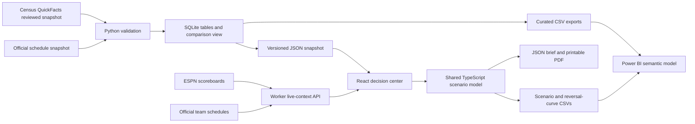

# Architecture

The app is stateless on the server except for a short-lived in-memory upstream cache. A Worker instance caches successful observations for 30 seconds and shares in-flight requests. Browsers poll once per minute while visible. Upstream timeouts are bounded; failures retain the original checked time and expose stale status. No user credentials, arbitrary upstream URLs, or customer records are accepted by the API.

The reference build is offline and deterministic except for the separately exported operational run timestamp/duration. Input SHA-256 hashes travel with the JSON snapshot. SQLite check constraints and tests validate keys, counts, ranges, and transformation results. Production API responses are never treated as a replacement for historical evidence or first-party revenue data.

Tables have explicit grains: markets are one row per parish/county; games one row per official game identifier; source_runs one row per snapshot build. The comparison view derives descriptive differences from the single Orleans reference. Application scenarios remain separate from geographic observations so changing a market does not silently invent acquisition performance.

A JSON brief retains selected game provenance, market provenance, input assumptions, model version, formula, derived results, reversal threshold, stress ranges, limitations, and a proposed measurement design. Print output adds a provenance appendix. No project planning notes or applicant-specific decisions are shipped with application source.

Power BI model/visual metadata is generated as PBIP/PBIR source and checked against Microsoft's published report schemas. The model has contextual Markets/Games tables and a Scenarios-to-Curves relationship. DAX mirrors the campaign formula; its execution must be checked in Desktop separately from TypeScript tests.
