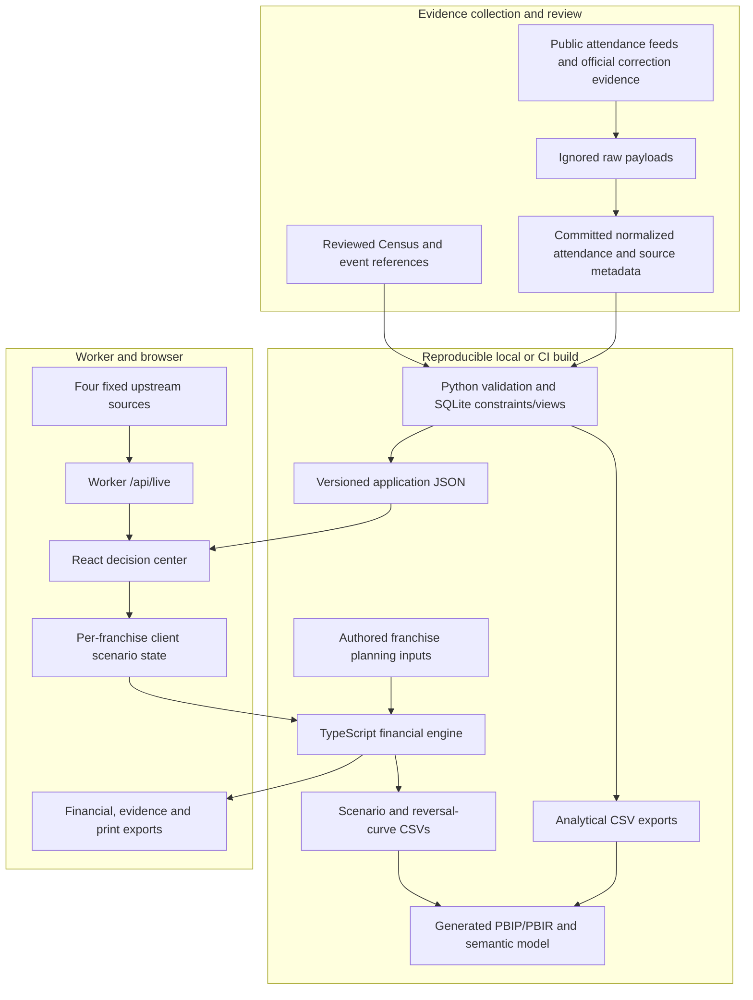

# System architecture and engineering decisions

This document describes the implemented system. Future services are identified as future work, not presented as deployed infrastructure.

NOLA PULSE has three responsibilities: preserve reviewable public evidence, calculate conditional campaign economics, and present a decision with its reversal condition. It has no private team-data integration, trained forecasting model, customer identity system, or transaction-processing role.

## Components and boundaries

| Component | Implementation | Responsibility |
| --- | --- | --- |
| Evidence ingestion | Python standard library | Retrieve fixed public endpoints; normalize event records; retain raw payloads locally and source hashes in version control |
| Analytical build | Python and SQLite | Enforce keys/ranges, aggregate reviewed rows, generate web JSON and analytical CSVs |
| Application | React 19, TypeScript, Vinext/Vite | Financial brief, scenario editing, attendance analysis, market map and evidence inspection |
| Live-context service | Cloudflare Worker route | Retrieve and normalize current game context and official home schedules |
| Financial engine | Pure TypeScript functions | Validate assumptions, calculate economics, reversal thresholds and stress results |
| Report handoff | Generated Power BI project | Import the same analytical exports and provide reviewable report/model definitions |

The public application requires no production database. The hosting manifest does not configure D1 or R2 storage. Generated SQLite databases are local analytical artifacts. No scheduler or background ingestion service is deployed.

## Evidence contracts and data grains

| Entity | Grain / identity | Contract |
| --- | --- | --- |
| Regional market | One county/parish per five-digit FIPS key | Positive population, households and income; source URL, review date and distinct population/income vintages |
| Reference game | One official game identifier | Franchise, opponent, timestamp, venue and official source provenance |
| Attendance game | One provider event identifier | Completed regular-season home game played in New Orleans; positive integer attendance; source identity and correction flag |
| Attendance rollup | One franchise and season | Count, sum, mean, minimum and maximum computed by SQL from reviewed game rows |
| Source run | One snapshot-build record | Count, timestamp, duration and status; operational metadata remains distinct from deterministic analytical output |
| Planning case | One explicit assumption set | Budget, acquisition cost, incrementality, tickets per order, contribution, other costs and ticket yield |
| Reversal-curve point | One scenario and incremental-share value | Net contribution with other inputs held fixed |

The SQL files define keys and check constraints. Attendance builds additionally verify source IDs, allowed source URL prefixes, timestamps and database integrity. SQLite rejects duplicate event identifiers; ingestion does not silently average duplicate records.

Source hashes identify the exact bytes used; they do not prove the source is correct. Reviewed corrections therefore have their own source, value and reason. The zero attendance correction and the neutral/postponed exclusions are documented in [Attendance evidence](ATTENDANCE.md).

Checked-in JSON is generated from reviewed inputs, not scraped during a page load. Rebuilding the same reviewed inputs reproduces the analytical snapshots. Refreshing public sources is a separate operation that can change the evidence vintage. CI checks generated web/report files for drift; it does not automatically accept newly retrieved observations.

## Financial calculation boundary

`web/lib/scenario.ts` owns the underlying campaign model, input validation, sensitivity ranges and threshold logic. `web/lib/campaign-finance.ts` extends that result with ticket yield, variable ticket costs, revenue, total cash costs and contribution ROI. Both the browser and `web/scripts/export-analytics.mjs` import these functions.

`web/data/campaign-plans.json` provides distinct authored examples for Pelicans and Saints. Their inputs are not inferred from attendance, income, franchise identity or an unavailable sales feed. A geographic selection changes context, not financial coefficients.

The engine rejects nonfinite inputs, nonpositive acquisition cost or tickets per order, negative spend/contribution, and incrementality outside zero to one. The financial extension also requires finite ticket yield covering contribution per ticket, preventing negative derived variable cost. Undefined ratios return `null`; the UI does not turn them into zero. Thresholds beyond 100% remain infeasible. Tests reconcile cash flows and evaluate the exact threshold plus values on both sides.

Money calculations use JavaScript numbers and retain precision until display. This is a planning model, not an accounting ledger. A future transaction-level reconciliation system would need an explicit currency, decimal and rounding contract rather than reusing display arithmetic.

The financial brief includes input origin and formulas. Export construction validates required contextual provenance. This establishes traceability, not independent verification of an assumed value. [Financial model](FINANCIAL-MODEL.md) defines the equations and the difference between attribution and incrementality.

## Client state and franchise interaction

The selected franchise is saved in browser local storage when available. Pointer hover and keyboard focus preview another franchise; selection keeps it. If storage is blocked, selection continues to work in memory.

Campaign inputs, pinned comparisons and selected game context are separate per-franchise React state. Scenario edits are not durable records, shared workspaces or server-side saved recommendations. A reload can restore the authored planning inputs; export a brief to retain a case. Financial input changes do not call a calculation API or upload the scenario.

Charts summarize the decision or historical evidence. Source ledgers remain available for inspection. A chart and an expanded source ledger have different review purposes; the opening financial brief does not repeat an aggregate chart as a summary table.

## Live-context request path

1. When mounted, the live-context component requests `/api/live` and refreshes every 60 seconds while the document is visible. Its client timeout is 16 seconds.
2. The Worker requests NBA and NFL scoreboards plus the two official team schedule pages concurrently. URLs are fixed in the route; callers cannot supply an arbitrary upstream.
3. Each upstream has a 12-second timeout. An adapter converts provider-specific structures into a normalized contract.
4. Successful results are cached for 30 seconds in that Worker instance. A pending-request map coalesces concurrent requests for the same URL within that instance.
5. Each feed returns data, its original checked timestamp and a stale flag. Refresh failure retains a previous successful observation when available; otherwise data is unavailable.

An instance-local cache can disappear on eviction, and separate instances can fetch the same upstream. It is an optimization, not a shared store or a freshness guarantee. Responses use `Cache-Control: no-store`. A successful API response can still contain a failed or stale constituent feed; consumers inspect feed-level status.

Official schedules provide event context. ESPN supplies explicitly attributed third-party scores. These sources are not blended into a single undocumented score observation. Times display in `America/Chicago`; the Saints adapter's interpretation of offset-free timestamps is recorded in [Methodology](METHODOLOGY.md).

## Power BI execution boundary

The report contains five import tables: Attendance, Markets, Games, Scenarios and Curves. The one-to-many Scenarios-to-Curves relationship filters the reversal curve. Context tables are not joined into an invented revenue relationship. The attendance page has its own franchise/season scope.

Fourteen measures and sixteen visuals are generated as source. The TypeScript exporter supplies financial scenario rows; DAX separately mirrors the financial arithmetic. Microsoft's report schemas validate metadata structure, not DAX behavior, import success, font layout or visual rendering. Native Windows acceptance remains required. The website's matched prior-season comparison is not claimed as a native DAX measure.

## Design decisions and tradeoffs

| Decision | Why it fits this release | Cost / reconsideration trigger |
| --- | --- | --- |
| Versioned snapshots instead of runtime historical scraping | Evidence remains reviewable and the demo works without upstream availability | New data needs review, regeneration and publication. Scheduled demand would justify durable ingestion and snapshot storage. |
| SQLite build pipeline instead of an operational warehouse | The reviewed dataset is small, relational and reproducible with standard-library tools | Multi-user querying, larger histories or authorized private feeds would justify a managed analytical store. |
| Shared TypeScript financial engine | Web calculations and CSV exports use the same implementation | DAX still needs parity checks. Additional consumers should consume a versioned contract rather than duplicate formulas. |
| Deterministic simulation instead of a prediction claim | No observed campaign response or holdout dataset supports learned profit estimates | Attendance ML needs chronological evaluation and a baseline; campaign return needs outcome and causal evidence. |
| Instance-local cache instead of distributed caching | Bounds repeated requests within an instance without provisioning another service | High traffic or provider quotas would require coordinated caching, backoff, monitoring and source-usage review. |
| Client-only scenario state | Fast interaction with no account setup or server collection of inputs | Collaboration, saved decisions or private data requires authentication, authorization, persistence and an audit trail. |
| Generated report source instead of a committed PBIX | Model and visual changes can be reviewed and rebuilt | Desktop remains an independent runtime; source/schema checks cannot replace Windows verification. |
| Brand identity separate from analytical semantics | Team selection does not change the meaning of positive/negative results | Any new charts must preserve labels, signs, readable contrast and consistent statistical meaning. |

These decisions describe public implementation tradeoffs. Personal planning and application notes are not part of the application source.

## Validation and operational limits

The current Python and JavaScript suites cover pipeline integrity, geography, attendance rules, financial reconciliation, exact reversal behavior, invalid inputs, provenance and provider normalization. CI also checks types, lint, formatting, generated-file drift and a production build. Schema validation is a separate networked check. Manual browser checks are recorded in [UI verification](UI-VERIFICATION.md); there is no committed browser automation suite.

No uptime SLO, load-test result, production alerting, durable audit log, user authentication system or continuous ingestion SLA is claimed. Public sources can change shape or cease to respond. Retained raw downloads are ignored locally, so a clean clone reproduces the reviewed normalized snapshot, not the original remote payloads from their hashes alone.

Before introducing private sales or customer records, define data permissions and minimization, the source-system contract, reconciliation grain, retention, access enforcement and audit requirements. Before presenting a forecast, define a chronological evaluation protocol, baseline, error metric and interval coverage. Before treating Power BI as complete, execute the documented Windows checks. These are requirements for the next system stage, not implemented capabilities.
